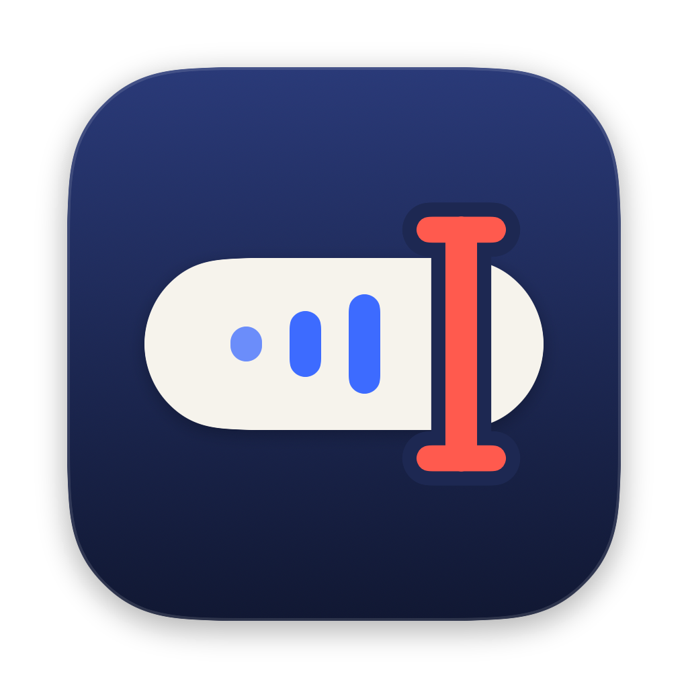
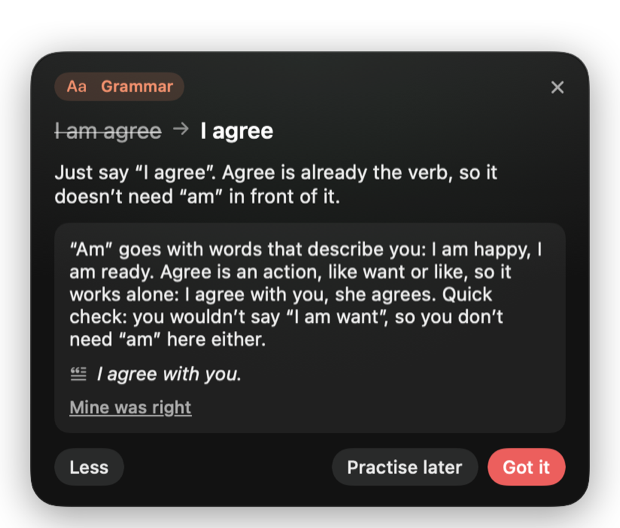
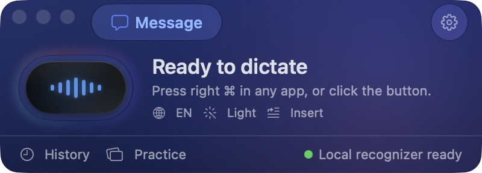
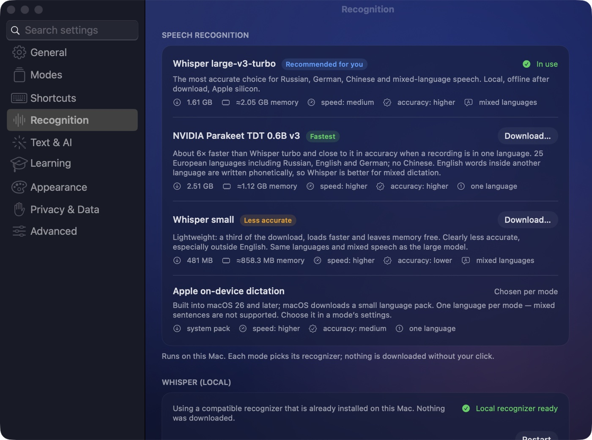

<p align="center"></p>

<h1 align="center">Saidright</h1>

<p align="center"><b>Speak freely.</b> Stop fearing imperfect words — set your speech free.<br>
Talk in any Mac app, your words appear at the cursor, and a friendly tip shows you the one mistake worth fixing.</p>

<p align="center"><a href="../../releases/latest"><b>Download for Mac</b></a> · <a href="https://gomin1i.github.io/saidright/">Website</a> · <a href="README.ru.md">Русский</a></p>

<p align="center">Free and open source · runs on your Mac · Apple silicon, macOS 14+</p>

<p align="center"></p>

## Practise a language every time you speak

Most people learning a language never get feedback on what they actually say. Saidright gives it to you **inside the work you are already doing** — an email, a chat message, a note — with no lessons to schedule.

- **Your sentence, corrected.** You dictate in the language you are learning. The text goes in as you said it; then a small card grows out of the capsule: *I am agree → I agree*.
- **Explained like a friend would.** One short reason in your own language, pitched to your level. Tap **Why?** for the rule and an example.
- **Only what matters.** One useful correction at a time, labelled as grammar, word choice, punctuation or style. Correct sentences get nothing — no praise, no noise.
- **Honest about the microphone.** If the problem might be the recognizer mishearing you, the tip says so and it never counts as your mistake.
- **Turn tips into skills.** *Practise later* saves a correction as a card for spaced review; your recurring topics show what to work on next.
- **Never in the way.** Tips never touch your text and never take keyboard focus. Keep typing; ⌃⌥L brings the last tip back.

Tips use a text model you choose: free and fully local through [Ollama](https://ollama.com), or your own cloud key. Tips work in any language your model knows; English and Russian are the most thoroughly tested so far.

## And a dictation app you will want to keep

- **Works everywhere.** Tap right ⌘ (or ⌃⌥Space), speak, tap again — the text appears where your cursor is. Ordinary shortcuts such as ⌘C never start a recording; Esc cancels.
- **Truly multilingual.** Around 100 languages, and you can switch between them mid-dictation. Foreign terms keep their own spelling — say, an English “pull request” inside a Russian sentence. Nothing is translated behind your back.
- **Fast and private.** Whisper large-v3-turbo or NVIDIA Parakeet run locally through MLX — about half a second per phrase, and audio never leaves your Mac. No account, no telemetry.
- **Smart formatting.** Dictate a few tasks and get a checklist; list things and get bullets; describe steps and get a numbered list. Ask for a table — “I need a table with three columns: ChatGPT, Claude and Gemini” — and get a real Markdown table. Ordinary sentences stay prose, and nothing you did not say is added.
- **Designed to be yours.** Saidright's indigo windows (light by day, deep at night), Liquid Glass or Ink capsule, palettes, size and motion — all previewed live.
- **Modes for every job.** Keep exactly what you said, tidy punctuation, fix grammar, or rewrite in a tone. Switch with ⌃⌥M.
- **Made to be yours.** Liquid Glass or Ink capsule, palettes, size, motion, sounds, light and dark, your own shortcuts — and a settings window with search.
- **Honest delivery.** If focus moved while you were speaking, nothing is pasted into the wrong place; the text waits on the clipboard.

<p align="center"> </p>

## Requirements

| | |
| --- | --- |
| Mac | Apple silicon (M1 or later); 16 GB memory recommended for Whisper turbo plus a local text model (with less than 12 GB Saidright suggests Whisper small) |
| macOS | 14 or later (Liquid Glass and Apple on-device dictation need macOS 26) |
| Disk | about 3 GB for Whisper turbo and its runtime; Parakeet adds 2.5 GB; Whisper small needs 0.5 GB |
| Network | only to download a recognizer once (and for a cloud text service, if you choose one) |
| Permissions | Microphone; Input Monitoring for single-key shortcuts such as right ⌘; Accessibility to paste into other apps |

## Install

1. Download `Saidright.dmg` from [Releases](../../releases/latest) and drag Saidright to Applications.
2. Open it once. macOS says it can't verify the developer — click **Done**.
3. **System Settings → Privacy & Security** → scroll down → *“Saidright was blocked…”* → **Open Anyway**, and confirm. (Free builds are not notarized; notarization needs a paid Apple Developer membership.)
4. Follow the introduction: languages, a recognizer download inside the app (checksum-verified), and the three permissions.

To verify the download, put `Saidright.dmg.sha256` from the release next to the DMG and run `shasum -a 256 -c Saidright.dmg.sha256`.

## Use

| Action | Default |
| --- | --- |
| Start / stop dictation | right ⌘ tap · ⌃⌥Space |
| Cancel | Esc |
| Next mode | ⌃⌥M |
| Show / close last tip | ⌃⌥L |

Dictate into any text field. The capsule at the bottom of the screen shows recording, processing and done; the text is pasted where you were typing. Open Saidright from the Dock for history, practice cards and Settings.

## Configuration

Everything is in **Settings** (⌘,), with search:

- **Modes** — spoken languages, recognizer (*Automatic*, Whisper, Parakeet, Apple), how much the text is edited, learning tips, where the text goes.
- **Shortcuts** — the dictation key or combination, toggle or hold-to-talk, mode switching.
- **Recognition** — install or remove recognizers, personal vocabulary for Whisper.
- **Text & AI** — editing and tips through Groq (recommended default: `openai/gpt-oss-120b`, fastest in our tests, free key), OpenAI, a local Ollama model or any OpenAI-compatible service; *Local only*.
- **Learning, Appearance, Privacy & Data, Advanced** — tip presentation, capsule look, history retention and export, automation links, diagnostics.

Data lives in `~/Library/Application Support/Saidright` (settings, modes, history, downloaded models). Keys are in the Keychain.

## Languages

| | |
| --- | --- |
| Interface | English, Русский, Deutsch, 简体中文 |
| Recognition | about 100 languages with Whisper (Chinese included), 25 European languages with Parakeet; several languages in one dictation |
| Measured so far | Russian, English, German, Chinese and mixed-language speech; other languages are marked as less tested in the app |
| Language tips | any language the chosen text model knows; most tested: English and Russian |

## Accuracy and speed

Measured on an M4 Pro. Real speech: 100 Google FLEURS clips; mixed and code-switched speech: synthetic clips ([eval/results](eval/results)).

| Recognizer | Per short phrase | Word errors RU / EN / DE (FLEURS) | Mixed languages | Foreign terms in a sentence |
| --- | --- | --- | --- | --- |
| Whisper large-v3-turbo | ≈0.5 s | 4.1 / 3.6 / 4.4 % | 3.1–3.4 % | kept as written |
| Parakeet TDT 0.6B v3 | ≈0.1 s | 6.1 / 4.3 / 5.6 % | drops the other language | written phonetically |

Your voice and microphone will differ; synthetic clips check plumbing, not natural accents.

## Build from source

Requires Xcode 26 or later (Swift 6 toolchain).

```
scripts/check.sh                 # everything CI runs: tests, build, strings, scripts, secret scan
scripts/build-app.sh             # → build/Saidright.app
open build/Saidright.app
```

`SAIDRIGHT_SIGN_IDENTITY=- SAIDRIGHT_BUILD_DIR=build/public scripts/build-app.sh` makes an ad hoc signed build for sharing. Pull requests, releases and the product page are automated with GitHub Actions — see [docs/GITHUB.md](docs/GITHUB.md).

## Security and privacy

Audio is processed on the Mac; keys stay in the Keychain; downloads are checksum-verified; nothing is collected. Details and how to report a vulnerability: [SECURITY.md](SECURITY.md) and [docs/PRIVACY.md](docs/PRIVACY.md).

## Limitations

- Apple silicon only. Tested most on the newest macOS; 14–15 are expected to work but are less tested.
- Some apps (browsers, Electron) do not expose field contents, so insertion is reported as “pasted, not verifiable”.
- Secure Input (password fields, some terminals) hides keys from all apps; Saidright then copies instead of pasting.
- Pronunciation, accent and fluency are not assessed — a transcript can't support that.

## Documentation

[How recognition works](docs/RECOGNITION.md) · [Architecture](docs/ARCHITECTURE.md) · [Testing](docs/TESTING.md) · [Models & licences](docs/MODELS_AND_LICENSES.md) · [Privacy](docs/PRIVACY.md) · [Design](docs/DESIGN.md) · [GitHub workflow](docs/GITHUB.md) · [Release](docs/RELEASE.md) · [Changelog](CHANGELOG.md) · [Contributing](CONTRIBUTING.md) · [Security](SECURITY.md)

## Licence and credits

Saidright is licensed under the [Apache License 2.0](LICENSE); see [NOTICE](NOTICE). Speech models are downloaded on request and are not part of the app: OpenAI Whisper (MIT) and NVIDIA Parakeet TDT 0.6B v3 (CC BY 4.0, © NVIDIA). Built with [MLX](https://github.com/ml-explore/mlx), [mlx-whisper](https://github.com/ml-explore/mlx-examples) and [parakeet-mlx](https://github.com/senstella/parakeet-mlx). Saidright is not affiliated with Apple, OpenAI, NVIDIA or Google.
